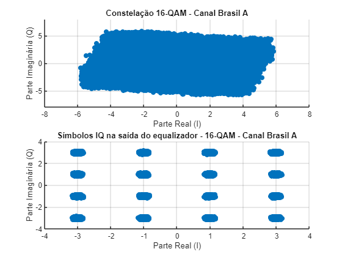
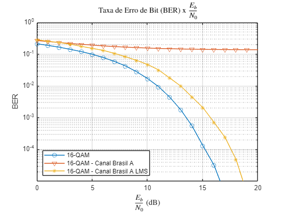

# LMS Equalization of QPSK and 16-QAM over Dispersive Channels

MATLAB simulation developed for the *Digital Communication Systems Lab I* course taught by Prof. Candice Müller.

This experiment extends the QPSK / 16-QAM link from [Performance Evaluation of QPSK and 16-QAM Systems](../Performance%20Evaluation%20of%20QPSK%20and%2016-QAM%20Systems) by replacing the ideal AWGN channel with multipath (dispersive) channels, and then recovering the signal with an adaptive LMS equalizer.

## What this project covers

**Theoretical part**
- Modeling two multipath channel profiles, *Brazil A* and *Brazil B*, from their delay and attenuation tables (six paths each).
- Converting attenuations (dB) to amplitudes and delays (µs) to samples.
- Deriving each channel's difference equation and transfer function, written as an FIR filter.
- Computing the impulse response, magnitude and phase of the frequency response.

**Practical part**
- QPSK and 16-QAM transmitter with RRC pulse shaping (roll-off 0.35) and carrier modulation.
- Transmission through channel A and channel B, followed by AWGN.
- Spectrum of the signal at the transmitter output and at the receiver input.
- IQ constellations at the demapper input, with and without the dispersive channel.
- BER curves over SNR from -20 dB to 20 dB, for both modulations and both channels.
- Adaptive LMS equalizer trained with a known symbol sequence:
  - error versus sample index during training;
  - effect of the step size on convergence;
  - constellation at the equalizer output;
  - BER curves with the equalizer, compared against the unequalized channel.

## Main parameters

| Parameter | Value |
|---|---|
| Symbol rate | 1 MHz |
| Upsampling factor | 8 |
| Sampling frequency | 8 MHz |
| Carrier frequency | 2 MHz |
| Pulse shaping | Root-raised cosine, roll-off 0.35, span of 12 symbols |
| Bitstream length | 500,000 bits |
| Frequency response resolution | 4096 points |

## Results

### Constellation before and after the LMS equalizer (16-QAM, Brazil A channel)

<p align="center">
  
</p>

The multipath channel smears the 16-QAM symbols into a single cloud at the demapper input (top). After the LMS equalizer is trained, the 16 constellation points become clearly separated again (bottom).

### BER with and without equalization (16-QAM, Brazil A channel)

<p align="center">
  
</p>

Without equalization, the BER over the Brazil A channel barely improves as the SNR increases. With the LMS equalizer the curve drops again and ends up roughly 2 dB from the reference 16-QAM curve.

The full set of plots (spectra, constellations for both channels, error curves and step-size comparison) is in the PDF report.

## Repository contents

```
<experiment folder>/
├── README.md
├── exp9.mlx            (main Live Script)
├── <function files>.m  (modulator, demodulator, BER curves, LMS, ...)
└── results/
    ├── exp9_report.pdf (full report: code, equations and figures)
    ├── constellation_16qam_channel_a_lms.png
    └── ber_16qam_channel_a_lms.png
```

The full report with every figure is available in [`results/report.pdf`](results/exp9_report.pdf).

## Tools

- MATLAB (Communications Toolbox: `awgn`, `rcosdesign`)

## References

1. HAYKIN, S. Adaptive Filter Theory, 3rd ed., Prentice Hall, Upper Saddle River, New Jersey, 1996. 
2. WIDROW, B., McCOOL, J. BALL, M. The Complex LMS Algorithm, Proceedings of IEEE, vol. 63, no 4, pp. 719-720, Abril, 1975. )
3. MÜLLER, C. LMS Equalization of QPSK and 16-QAM over Dispersive Channels, Lab guide. Santa Maria: Federal University of Santa Maria (UFSM), 2024.
