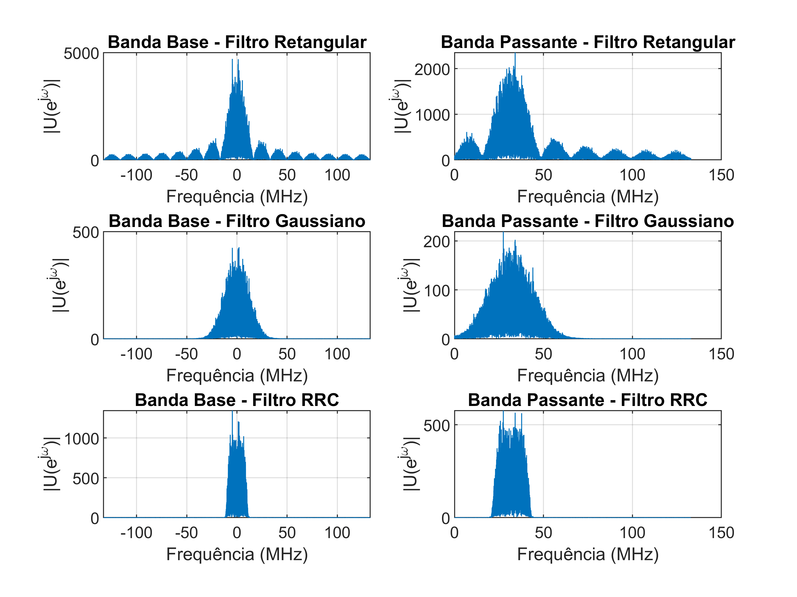

# QPSK and 16-QAM Modulators with Pulse Shaping Filters

MATLAB implementation developed for the *Digital Communication Systems Lab I* course (Federal University of Santa Maria, UFSM), taught by Prof. Candice Müller.

This project builds the transmitter side of a digital communication system, from the bitstream to the signal that goes into the D/A converter, and compares three pulse shaping filters by looking at how they shape the signal spectrum.

## What this project covers

- **Symbol mapping**: a QPSK mapper function (`mapper_QPSK`) and a 16-QAM mapper function (`qam16_mapper`), both verified against every possible bit combination.
- **Upsampling** of the I and Q streams (inserting k-1 zeros after each sample).
- **Pulse shaping filters**, compared in time and frequency:
  - rectangular (16 samples);
  - Gaussian (K0 = 0.17, τ = 33 ns);
  - root-raised cosine, RRC (roll-off 0.35, span of 12 symbols).
- **Heterodyning**: translation from baseband to a 32 MHz carrier, producing the signal u(n) applied to the D/A converter, with the start and end of each IQ symbol marked on the waveform.
- **Spectrum analysis** in baseband and passband, including the phase inversion that appears between antipodal symbols (180° apart in the constellation).
- **Bandwidth checks** against the analytical values for each filter.
- **Change of operating point**: halving the upsampling factor and doubling the symbol rate while keeping the same sampling frequency.
- **16-QAM modulator** running through the same chain, compared with QPSK.

## Main parameters

| Parameter | Value |
|---|---|
| Symbol rate | 16.6 MHz |
| Carrier frequency | 32 MHz |
| Upsampling factor (k) | 16 |
| Sampling frequency | SR × k |
| Random bitstream | 10,000 bits |

## Results

### Comparing the three pulse shaping filters

<p align="center">
  
</p>

Baseband (left) and passband (right) spectra for the rectangular, Gaussian and RRC filters. The rectangular pulse has abrupt transitions in time, so its spectrum is a sinc with sidelobes that spread over high frequencies. The Gaussian and RRC filters have smooth transitions and limit the spectrum, and the RRC gives the narrowest one, since its frequency response falls more steeply.

### Other observations

- Translating the signal to the carrier frequency doubles the bandwidth and halves the amplitude, as expected from the modulation property of the Fourier transform.
- The Gaussian filter's bandwidth follows √2/τ, and the RRC filter's follows SR·(1 + α). Both matched the measured spectra.
- Doubling the symbol rate with the RRC filter doubles its bandwidth (22.41 MHz to 44.82 MHz).
- QPSK and 16-QAM have the same bandwidth with the same RRC filter and symbol rate. The 16-QAM signal has a larger amplitude because its constellation is not normalized.

The full report with every plot and the analysis of each item is in the PDF.

## Repository contents

```
<experiment folder>/
├── README.md
├── <main Live Script>.mlx
├── mapper_QPSK.m
├── qam16_mapper.m
└── results/
    ├── exp5_report.pdf (full report: code, figures and analysis)
    └── filter_comparison_spectra.png
```

The mapper functions created here are reused in the later experiments of this repository.

## Tools

- MATLAB (`rcosdesign`, `freqz`, `upsample`, `conv`)

## References

1. HAYKIN, S., MOHER, M. *Sistemas de Comunicação*, 5th Ed. Porto Alegre: Bookman, 2011.
2. PROAKIS, J. G., SALEHI, M. *Communication Systems Engineering*, 2nd Ed. New Jersey: Prentice Hall, 2002.
